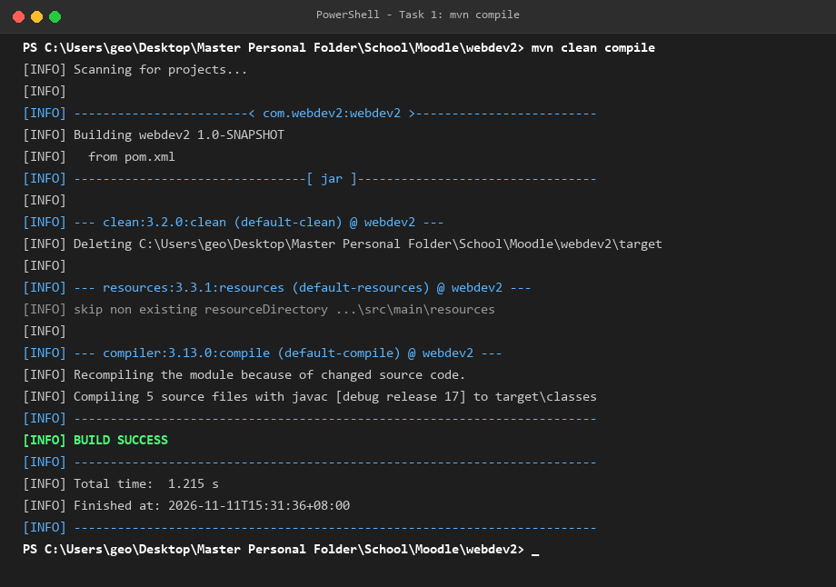
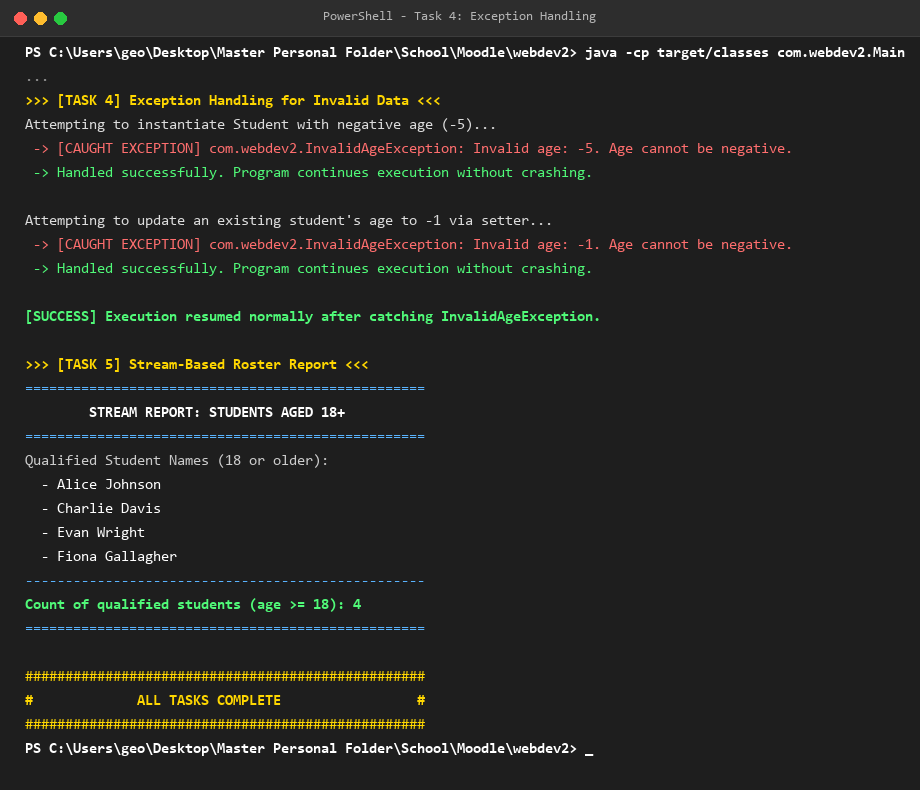
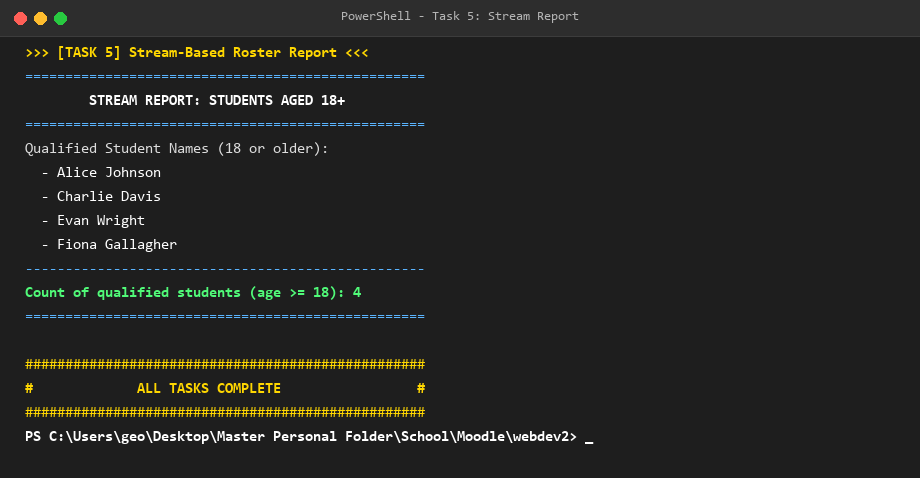
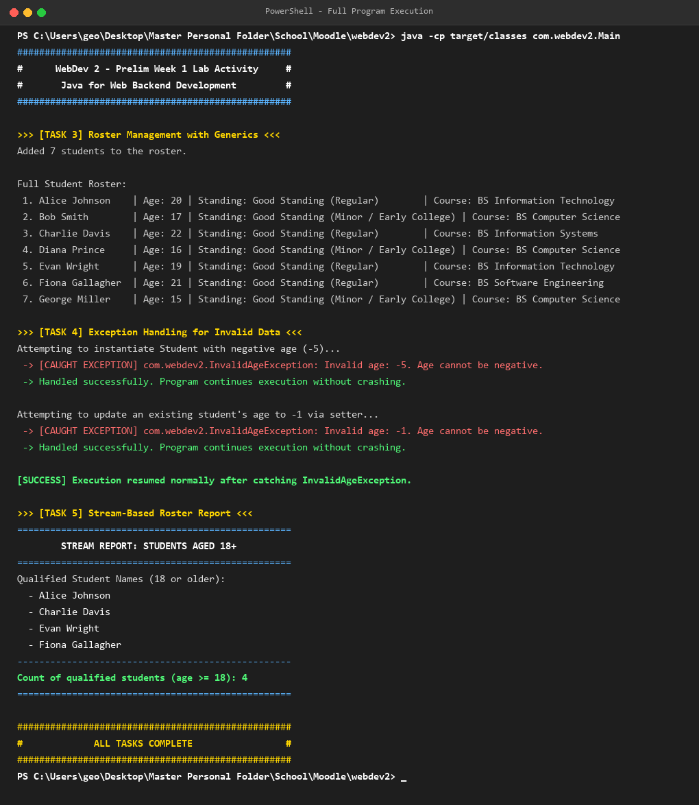

# WebDev 2 — Week 1: Java for Web Backend Development

**Term:** Prelim · **Week:** 1  
**Student:** geoxify (`geoffbenedict.carino@lorma.edu`)  
**Repository:** `webdev2`  
**Branch:** `week1`  
**Collaborator Added:** `johnverz22`  

---

## 📌 Table of Contents
1. [Overview & Learning Outcomes](#overview--learning-outcomes)
2. [Project Structure](#project-structure)
3. [Implementation Details](#implementation-details)
   - [Task 1: Maven Project Setup](#task-1--maven-project-setup)
   - [Task 2: Encapsulated Domain Classes & Interface](#task-2--encapsulated-domain-classes--interface)
   - [Task 3: Roster Management with Generics](#task-3--roster-management-with-generics)
   - [Task 4: Exception Handling for Invalid Data](#task-4--exception-handling-for-invalid-data)
   - [Task 5: Stream-Based Roster Report](#task-5--stream-based-roster-report)
4. [Build & Execution Guide](#build--execution-guide)
5. [Evidence & Screenshots](#evidence--screenshots)
6. [Acceptance Criteria Checklist](#acceptance-criteria-checklist)

---

## 🎯 Overview & Learning Outcomes
This project applies core Java Object-Oriented Programming (OOP) principles, generic collections, runtime exception handling, and functional stream pipelines that serve as the foundation for modern Spring Boot backend development.

Key topics covered:
- **Project Configuration:** Declarative build management using Apache Maven and Java 17.
- **Encapsulation & Polymorphism:** Private instance fields, validation within mutators, interface contracts, and implementation (`Gradable`).
- **Collections & Generics:** Type-safe collection handling using `List<Student>` and `ArrayList<Student>`.
- **Structured Exception Handling:** Custom unchecked runtime exceptions (`InvalidAgeException`) and `try/catch` recovery without termination.
- **Java Streams API:** Declarative stream pipelines combining intermediate operations (`filter`, `map`) with terminal operations (`collect`, `count`).

---

## 📁 Project Structure

```text
webdev2/
├── pom.xml
├── .gitignore
├── README.md
├── screenshot/
│   ├── task1_mvn_compile.png
│   ├── task4_exception_handling.png
│   ├── task5_stream_report.png
│   └── full_program_execution.png
└── src/
    └── main/
        └── java/
            └── com/
                └── webdev2/
                    ├── Gradable.java
                    ├── InvalidAgeException.java
                    ├── Main.java
                    ├── Roster.java
                    └── Student.java
```

---

## 🛠️ Implementation Details

### Task 1 — Maven Project Setup
- Configured `pom.xml` with:
  - `groupId`: `com.webdev2`
  - `artifactId`: `webdev2`
  - `version`: `1.0-SNAPSHOT`
  - Java 17 specified as the source, target, and release level.
- Cleanly compiles using `mvn compile`.

### Task 2 — Encapsulated Domain Classes & Interface
- **`Gradable.java`**: Interface specifying `computeStanding()`.
- **`Student.java`**: Implements `Gradable`.
  - Private attributes: `name` (String), `age` (int), `course` (String).
  - Parameterized constructor ensuring validation is triggered on object creation.
  - Public getters and setters for all fields.
  - Mutator `setAge(int age)` enforces non-negative constraints.
  - Implements `computeStanding()` to indicate academic standing.

### Task 3 — Roster Management with Generics
- **`Roster.java`**:
  - Encapsulates `List<Student> students` using Java Generics (no raw types).
  - Methods: `addStudent(Student student)` and `getStudents()`.
  - Initialized with 7 student records of varying ages (both minor `< 18` and adult `>= 18`) in `Main.java`.

### Task 4 — Exception Handling for Invalid Data
- **`InvalidAgeException.java`**: Custom unchecked exception extending `RuntimeException`.
- `Student.setAge(int age)` throws `InvalidAgeException` whenever `age < 0`.
- In `Main.java`, instantiation attempts and setter invocations with negative age values are surrounded by `try/catch` blocks.
- The exception is caught, logged with details, and execution proceeds uninterrupted.

### Task 5 — Stream-Based Roster Report
- **`generateAdultStudentsReport()`** in `Roster.java`:
  - **Filter**: Filters students who are 18 or older (`.filter(s -> s.getAge() >= 18)`).
  - **Map**: Extracts only student names (`.map(Student::getName)`).
  - **Terminal / Count**: Collects names into `List<String>` and counts qualifying students using stream counting (`.count()`).

---

## 🚀 Build & Execution Guide

### 1. Compile the Project
```bash
mvn compile
```

### 2. Run the Main Application
```bash
java -cp target/classes com.webdev2.Main
```

---

## 📸 Evidence & Screenshots

All screenshots are stored under the `screenshot/` directory:

### Task 1: Successful `mvn compile`


### Task 4: Exception Handling & Program Continuity


### Task 5: Stream Report Output


### Full Program Execution


---

## ✅ Acceptance Criteria Checklist

| Task | Criterion | Status |
|---|---|:---:|
| **Task 1** | Builds cleanly with `mvn compile`, no errors; Java 17 declared in `pom.xml` | **PASS** |
| **Task 2** | `Student` fields are `private`; age setter enforces non-negative / throws exception; `Gradable` is a true interface implemented by `Student` | **PASS** |
| **Task 3** | `Roster` uses `List<Student>` with generics; at least 6 students populated and printed | **PASS** |
| **Task 4** | `InvalidAgeException` extends `RuntimeException`; invalid age caught, logged, and execution continues without crashing | **PASS** |
| **Task 5** | Stream pipeline chains `filter`, `map`, and terminal operation; correctly reports students aged 18+ and count | **PASS** |
