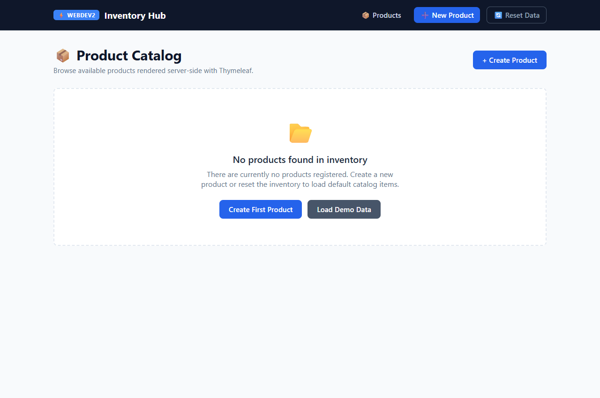
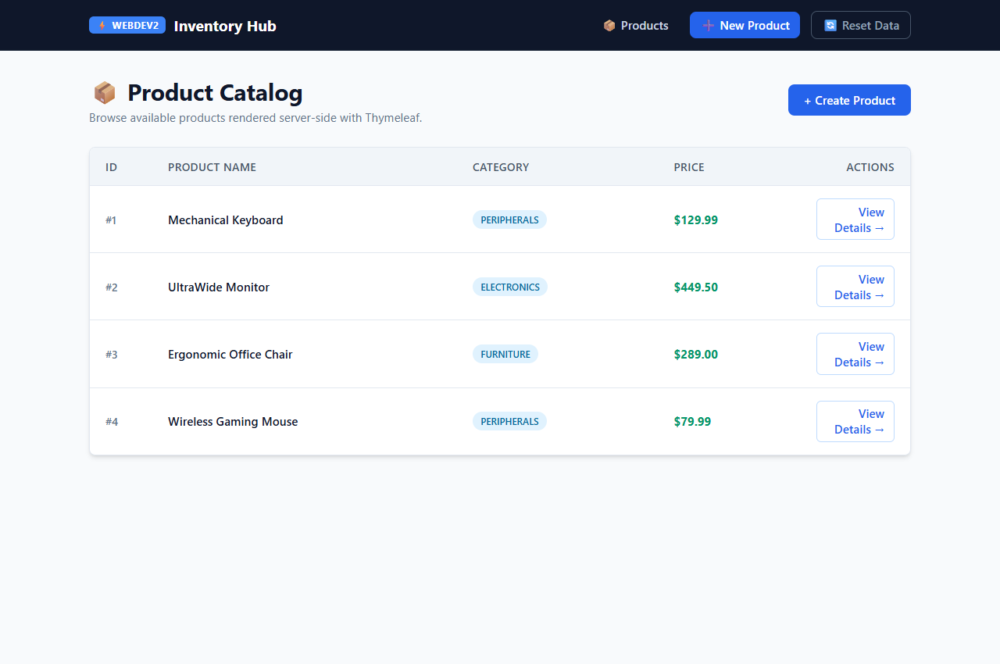
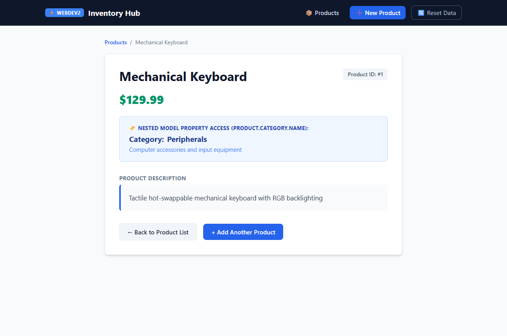
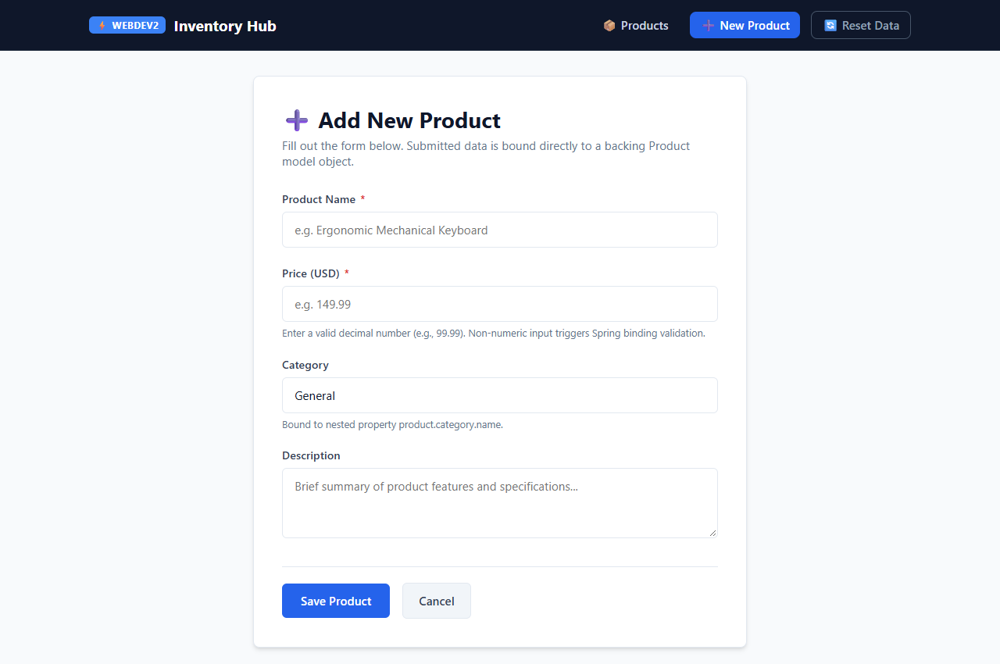
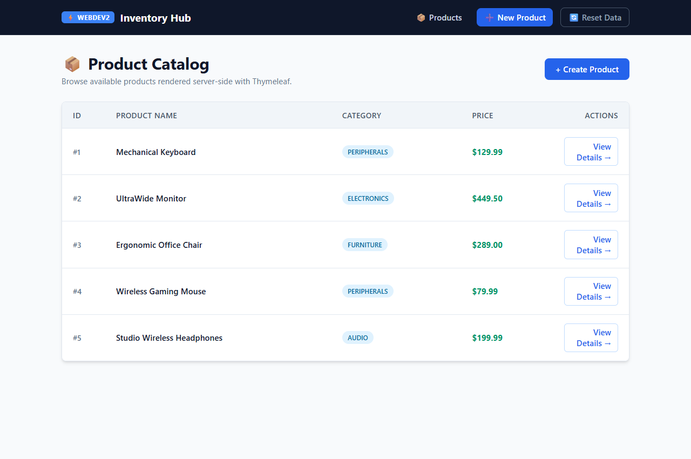
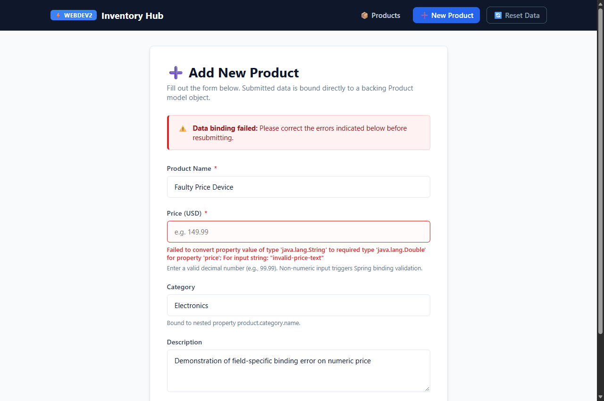

# WebDev 2 — Week 4: Server-Side Rendering with Thymeleaf

**Course:** WEBDEV2  
**Term:** Prelim · **Week:** 4  
**Student:** geoxify (`geoffbenedict.carino@lorma.edu`)  
**Repository:** `https://github.com/geoxify/webdev2`  
**Branch:** `week4`  
**Submission URL:** `https://github.com/geoxify/webdev2/tree/week4`  

---

## 📌 Table of Contents
1. [Overview & Learning Outcomes](#-overview--learning-outcomes)
2. [Project Architecture & Directory Structure](#-project-architecture--directory-structure)
3. [Task 1 — Product List Template (`products.html`)](#-task-1--product-list-template)
4. [Task 2 — Product Detail Template (`product-detail.html`)](#-task-2--product-detail-template)
5. [Task 3 — Shared Navigation Fragment (`fragments/navbar.html`)](#-task-3--shared-navigation-fragment)
6. [Task 4 — Create Form (`product-form.html`)](#-task-4--create-form)
7. [Task 5 — Binding Errors on the Create Form](#-task-5--binding-errors-on-the-create-form)
8. [Thymeleaf Expression Syntax Guide](#-thymeleaf-expression-syntax-guide)
9. [Verification & Acceptance Criteria Checklist](#-verification--acceptance-criteria-checklist)
10. [Build & Execution Guide](#-build--execution-guide)

---

## 🎯 Overview & Learning Outcomes
This project implements a complete server-rendered web application using Spring Boot and Thymeleaf. Building on the Spring MVC controllers established in previous weeks, dynamic model data is rendered into structured HTML templates, shared layout markup is modularized into reusable fragments, and form submissions are bound directly to Java domain objects with error handling and validation.

### Key Objectives Achieved:
- **Server-Side Templating:** Configured `spring-boot-starter-thymeleaf` to process dynamic HTML views located in `src/main/resources/templates/`.
- **Dynamic Content & Iteration:** Leveraged `th:each` and `th:text` to dynamically display collections of model objects, combined with `th:if` conditional evaluation for empty collection states.
- **Variable Expressions & Nested Property Access:** Utilized `${...}` expressions to drill down through nested model properties (`product.category.name`, `product.category.description`).
- **Template Modularity & Fragment Reuse:** Extracted shared layout headers into `fragments/navbar.html` using `th:fragment="navbar"` and included it seamlessly across templates with `th:replace`.
- **Form Object Binding:** Bound HTML forms to backing `Product` model instances using `th:object="${product}"`, `th:field="*{name}"`, and link expressions `th:action="@{/products}"`.
- **Data Binding Validation & Error Surfacing:** Captured type-conversion and binding errors using `BindingResult` immediately following `@ModelAttribute Product product` in the controller, redisplaying the form with preserved input and field-level error messages via `th:errors`.

---

## 📁 Project Architecture & Directory Structure

```text
webdev2/
├── .gitattributes
├── .gitignore
├── HELP.md
├── mvnw
├── mvnw.cmd
├── pom.xml
├── README.md
├── answers.md
├── screenshot/
│   ├── task1_product_list_rendered.png
│   ├── task1_empty_state_message.png
│   ├── task2_product_detail_nested_property.png
│   ├── task3_navbar_products_page.png
│   ├── task3_navbar_detail_page.png
│   ├── task4_product_form.png
│   ├── task4_post_redirect_success.png
│   └── task5_binding_error_redisplayed_form.png
├── src/
│   ├── main/
│   │   ├── java/
│   │   │   └── com/
│   │   │       └── example/
│   │   │           └── webdev2/
│   │   │               ├── Category.java
│   │   │               ├── Product.java
│   │   │               ├── ProductController.java
│   │   │               ├── HomeController.java
│   │   │               ├── Book.java
│   │   │               ├── BookController.java
│   │   │               └── Webdev2Application.java
│   │   └── resources/
│   │       ├── application.properties
│   │       └── templates/
│   │           ├── products.html
│   │           ├── product-detail.html
│   │           ├── product-form.html
│   │           └── fragments/
│   │               └── navbar.html
│   └── test/
│       └── java/
│           └── com/
│               └── example/
│                   └── webdev2/
│                       ├── ProductControllerTest.java
│                       └── Webdev2ApplicationTests.java
```

---

## 🛠️ Task 1 — Product List Template

### Implementation
- **Template:** `src/main/resources/templates/products.html`
- **Controller Method:** `ProductController.getAllProducts(@RequestParam(required = false) boolean empty, Model model)`
- **Endpoint:** `GET /products`
- **Thymeleaf Features Used:**
  - `th:each="product : ${products}"`: Iterates over the collection of products passed from the Spring `Model`.
  - `th:text="${product.name}"`: Evaluates and renders each product's name into the table cell.
  - `th:if="${products == null or #lists.isEmpty(products)}"`: Gates an empty-state alert card, rendering only when the list contains no items.
  - `th:if="${products != null and not #lists.isEmpty(products)}"`: Renders the table container only when products are present.

```html
<!-- Empty-state card shown ONLY when products list is empty -->
<div th:if="${products == null or #lists.isEmpty(products)}" class="empty-state">
    <span class="empty-icon">📂</span>
    <h3 class="empty-title">No products found in inventory</h3>
    <p class="empty-desc">There are currently no products registered. Create a new product or reset the inventory.</p>
</div>

<!-- Product Table rendered via th:each -->
<table th:if="${products != null and not #lists.isEmpty(products)}">
    <thead>
        <tr>
            <th>ID</th>
            <th>Product Name</th>
            <th>Category</th>
            <th>Price</th>
            <th>Actions</th>
        </tr>
    </thead>
    <tbody>
        <tr th:each="product : ${products}">
            <td th:text="${'#' + product.id}">#1</td>
            <td>
                <a th:href="@{/products/{id}(id=${product.id})}" th:text="${product.name}">Product Name</a>
            </td>
            <td>
                <span class="badge" th:text="${product.category != null ? product.category.name : 'General'}">Category</span>
            </td>
            <td th:text="${'$' + #numbers.formatDecimal(product.price, 1, 2)}">$0.00</td>
            <td>
                <a th:href="@{/products/{id}(id=${product.id})}" class="action-link">View Details →</a>
            </td>
        </tr>
    </tbody>
</table>
```

### Evidence
- Rendered product list displaying multiple active inventory items:  
  
- Conditional empty-state view (`GET /products?empty=true`):  
  

---

## 🔍 Task 2 — Product Detail Template

### Implementation
- **Template:** `src/main/resources/templates/product-detail.html`
- **Controller Method:** `ProductController.getProductById(@PathVariable Long id, Model model)`
- **Endpoint:** `GET /products/{id}`
- **Nested Property Architecture:**
  - `Product` has a direct reference to a `Category` object (`private Category category;`).
  - `Category` defines fields `id`, `name`, and `description`.
  - Thymeleaf navigates the object graph using standard dot notation: `${product.category.name}` and `${product.category.description}`.

```html
<div class="detail-card">
    <div class="header-meta">
        <!-- Direct property access -->
        <h1 class="product-title" th:text="${product.name}">Product Title</h1>
        <span class="product-id-tag" th:text="${'Product ID: #' + product.id}">Product ID</span>
    </div>

    <!-- Formatted price variable expression -->
    <div class="price-badge" th:text="${'$' + #numbers.formatDecimal(product.price, 1, 2)}">$0.00</div>

    <!-- Nested property access: product.category.name -->
    <div class="nested-property-card">
        <div class="nested-label">🏷️ Nested Model Property Access (product.category.name):</div>
        <div class="category-name">
            <span>Category:</span>
            <span th:text="${product.category.name}">Category Name</span>
        </div>
        <div class="category-desc" th:text="${product.category.description}">Category Description</div>
    </div>

    <!-- Description -->
    <div class="description-box" th:text="${product.description}">Product Description</div>
</div>
```

### Evidence
- Product detail view rendering product properties and resolved nested category name (`Peripherals`):  
  

---

## 🧩 Task 3 — Shared Navigation Fragment

### Implementation
- **Fragment File:** `src/main/resources/templates/fragments/navbar.html`
- **Fragment Declaration:** `th:fragment="navbar"` on the root `<header>` tag.
- **Inclusion Syntax:** Included in `products.html`, `product-detail.html`, and `product-form.html` using `th:replace="~{fragments/navbar :: navbar}"`.
- **Behavior:** With `th:replace`, the host placeholder tag is entirely replaced by the fragment markup, eliminating duplicated navigation code across views.

```html
<!-- Defined once in templates/fragments/navbar.html -->
<header th:fragment="navbar" class="site-header">
    <nav class="navbar">
        <div class="nav-container">
            <a th:href="@{/products}" class="nav-brand">
                <span class="brand-badge">⚡ WEBDEV2</span>
                <span class="brand-title">Inventory Hub</span>
            </a>
            <div class="nav-menu">
                <a th:href="@{/products}" class="nav-link">📦 Products</a>
                <a th:href="@{/products/new}" class="nav-link nav-btn-primary">➕ New Product</a>
                <a th:href="@{/products/reset}" class="nav-link nav-btn-outline" title="Reset sample data">🔄 Reset Data</a>
            </div>
        </div>
    </nav>
</header>
```

```html
<!-- Included in templates/products.html and templates/product-detail.html -->
<div th:replace="~{fragments/navbar :: navbar}"></div>
```

### Evidence
- Navbar appearing on the Product List page:  
  
- Identical Navbar appearing on the Product Detail page:  
  

---

## 📝 Task 4 — Create Form

### Implementation
- **Template:** `src/main/resources/templates/product-form.html`
- **Controller Methods:**
  - `GET /products/new`: Supplies a new `Product` instance via `model.addAttribute("product", new Product())`.
  - `POST /products`: Receives submitted form data, binds it to `@ModelAttribute Product product`, saves the entity, and redirects to `/products`.
- **Thymeleaf Form Binding Attributes:**
  - `th:object="${product}"`: Specifies the backing model object for the entire form.
  - `th:field="*{name}"`: Binds the input field to `product.name`, automatically populating `id`, `name`, and current `value`.
  - `th:field="*{price}"`: Binds the price input to `product.price`.
  - `th:field="*{category.name}"`: Binds nested property `product.category.name`.
  - `th:action="@{/products}"`: Specifies the submission destination URL using a link expression.

```html
<form th:action="@{/products}" th:object="${product}" method="post">
    <!-- Product Name -->
    <div class="form-group">
        <label for="name">Product Name *</label>
        <input type="text" id="name" th:field="*{name}" class="form-control" placeholder="e.g. Mechanical Keyboard" required />
    </div>

    <!-- Product Price -->
    <div class="form-group">
        <label for="price">Price (USD) *</label>
        <input type="text" id="price" th:field="*{price}" class="form-control" placeholder="e.g. 149.99" />
        <span class="field-error" th:if="${#fields.hasErrors('price')}" th:errors="*{price}">Price error</span>
    </div>

    <!-- Nested Category Name -->
    <div class="form-group">
        <label for="categoryName">Category</label>
        <input type="text" id="categoryName" th:field="*{category.name}" class="form-control" placeholder="e.g. Electronics" />
    </div>

    <!-- Description -->
    <div class="form-group">
        <label for="description">Description</label>
        <textarea id="description" th:field="*{description}" class="form-control"></textarea>
    </div>

    <div class="form-actions">
        <button type="submit" class="btn-submit">Save Product</button>
        <a th:href="@{/products}" class="btn-cancel">Cancel</a>
    </div>
</form>
```

### Evidence
- Backing-object-bound Create Form (`GET /products/new`):  
  
- Successful submission resulting in a 302 redirect back to `GET /products` with new product listed (`#5 Studio Wireless Headphones`):  
  

---

## ⚠️ Task 5 — Binding Errors on the Create Form

### Implementation
- **Controller Signature:**  
  ```java
  @PostMapping
  public String createProduct(@ModelAttribute Product product, BindingResult result, Model model) {
      if (result.hasErrors()) {
          return "product-form"; // Redisplay form without saving
      }
      // Save product and redirect
      ...
      return "redirect:/products";
  }
  ```
- **Ordering Constraint:** `BindingResult` **must immediately follow** `@ModelAttribute Product product` in the method signature. This allows Spring MVC to pair the validation errors specifically with that target object.
- **Type Conversion Failure:** When a user enters non-numeric text (`"invalid-price-text"`) into the `price` field, Spring's `WebDataBinder` attempts to convert `String` to `Double`. It catches the `NumberFormatException`, registers a `typeMismatch` `FieldError` on the `price` field in `BindingResult`, and sets `result.hasErrors() == true`.
- **Template Error Display:**
  - `th:errors="*{price}"`: Evaluates whether errors exist for property `price` and outputs the field error message.
  - `#fields.hasErrors('price')`: Used to conditionally apply an `input-error` CSS class (red border) to the offending input element.
  - Previous inputs (`name`, `category.name`, `description`) remain intact and are not lost.

```html
<div class="form-group">
    <label for="price">Price (USD) *</label>
    <input type="text"
           id="price"
           th:field="*{price}"
           th:classappend="${#fields.hasErrors('price')} ? 'input-error' : ''"
           class="form-control" />
    <!-- Task 5: Displays binding error message -->
    <span class="field-error" th:if="${#fields.hasErrors('price')}" th:errors="*{price}">
        Binding error message appears here
    </span>
</div>
```

### Evidence
- Redisplayed form after submitting non-numeric input for `price`, showing the field error message and preserved form input values:  
  

---

## 📖 Thymeleaf Expression Syntax Guide

| Syntax | Expression Type | Purpose & Scope | Example in Project |
|---|---|---|---|
| `${...}` | **Variable Expression** | Reads properties directly from the Spring `Model` object graph. Supports nested dot navigation. | `${product.name}`, `${product.category.name}` |
| `*{...}` | **Selection Expression** | Evaluates a property relative to the object previously selected by `th:object`. | `*{name}`, `*{price}`, `*{category.name}` |
| `@{...}` | **Link URL Expression** | Constructs context-aware application URLs and path-variable substitutions. | `@{/products}`, `@{/products/{id}(id=${product.id})}` |
| `~{...}` | **Fragment Expression** | Identifies and loads markup fragments defined by `th:fragment`. | `~{fragments/navbar :: navbar}` |
| `#fields.hasErrors(...)` | **Validation Helper** | Checks whether validation/binding errors exist for a specific form field or overall form. | `#fields.hasErrors('price')` |

---

## ✅ Verification & Acceptance Criteria Checklist

| Task | Requirement | Status | Evidence / Verification |
|---|---|---|---|
| **Task 1** | Render product list with `th:each` and `th:text`; `th:if`-gated empty state message. | **PASSED** | `templates/products.html` renders all catalog items; `?empty=true` renders clean empty-state message. Screenshots captured. |
| **Task 2** | Detail template for `GET /products/{id}` displaying name, price, and nested property (`product.category.name`). | **PASSED** | `templates/product-detail.html` displays product name, formatted price, and resolved category `Peripherals`. Screenshot captured. |
| **Task 3** | Modular navbar in `templates/fragments/navbar.html` included via `th:replace` on both list and detail views. | **PASSED** | Single navbar source file; renders identically on `/products` and `/products/1`. Screenshots verified. |
| **Task 4** | Form bound to `Product` via `th:object`, inputs bound via `th:field`, `POST /products` with PRG redirect. | **PASSED** | `templates/product-form.html` binds `name`, `price`, `category.name`. Valid POST redirects to `/products` with item created. |
| **Task 5** | `@ModelAttribute` + `BindingResult` in `POST /products`; returns form on errors; `th:errors` displays field error. | **PASSED** | Non-numeric input for price triggers `hasErrors() == true`, form redisplays preserving values with clear error banner and message. |

---

## 🚀 Build & Execution Guide

### Prerequisites
- JDK 17+ (built and tested with Oracle JDK 24)
- Apache Maven (bundled via `./mvnw.cmd`)

### Compiling and Running
```powershell
# 1. Switch to week4 branch
git checkout week4

# 2. Compile the application
.\mvnw.cmd clean compile

# 3. Package executable jar
.\mvnw.cmd clean package

# 4. Start the application
java -jar target/webdev2-0.0.1-SNAPSHOT.jar

# 5. Access the application in your browser
# Product Catalog:   http://localhost:8082/products
# Product Detail:    http://localhost:8082/products/1
# Add New Product:   http://localhost:8082/products/new
# Binding Error:     http://localhost:8082/products/error-demo
# Empty State Demo:  http://localhost:8082/products?empty=true
```

---

## 🔗 Submission Details
- **Student GitHub Username:** `geoxify`
- **Moodle Submission URL:**  
  `https://github.com/geoxify/webdev2/tree/week4`
